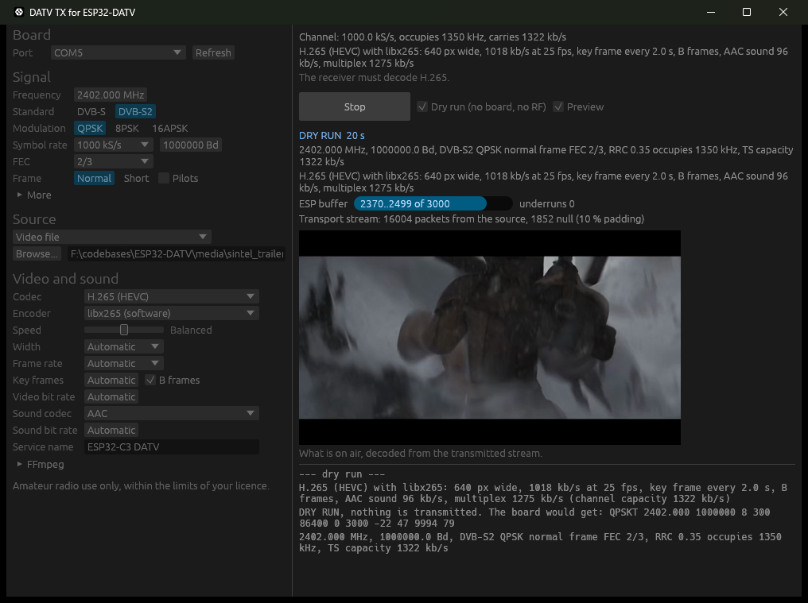

# DATV TX (Rust, Windows)

A transmitter for the ESP32-DATV firmware with a choice of video codec: **H.264, H.265 (HEVC),
H.266 (VVC) or AV1**, and of sound codec: **MP2, MP3, AAC, Opus, AC-3 or E-AC-3**. It is a Rust port of `host/tx_dvbs.py`: FFmpeg encodes picture and sound
and makes the transport stream, this program does the DVB-S / DVB-S2 coding and feeds the
ESP32-C3 over USB. The board needs the same firmware as the Flutter app and the Python script.



## What you need

- An ESP32-C3 with the ESP32-DATV firmware (flash it with the Flutter app or ESP-IDF).
- [FFmpeg](https://ffmpeg.org/download.html) on `PATH` (or set its path under Video > FFmpeg).
  The codecs offered are the ones your FFmpeg has an encoder for:

  | Codec | Encoders used (the first one found is the default) |
  |---|---|
  | H.264 | libx264, h264_nvenc, h264_qsv, h264_amf, h264_mf |
  | H.265 (HEVC) | libx265, hevc_nvenc, hevc_qsv, hevc_amf, hevc_mf |
  | H.266 (VVC) | libvvenc |
  | AV1 | libsvtav1, av1_nvenc, av1_qsv, av1_amf, libaom-av1 |

## Build and run

```sh
cd rust
cargo run --release                 # the window
powershell -ExecutionPolicy Bypass -File scripts\build-portable.ps1   # exe\datv-tx.exe, exe\datv-tx-cli.exe
```

Choose the port, the signal (frequency, DVB-S or DVB-S2, modulation, symbol rate, FEC), the
source (test pattern, video file, screen, camera, a ready `.ts`, null packets, carrier) and
the codecs, then press **Transmit**. Picture size, frame rate and bit rates follow the channel
capacity as in `tx_dvbs.py`, or set them yourself:

- **Speed**: encoder effort from Fastest to Slowest. Slower gives a better picture for the
  same bit rate and needs more processor.
- **Width** up to 1920 px (1080p) and **frame rate** up to 60 fps. The channel still carries
  what it carries: 1080p in 1 Mb/s is soft, whatever the codec.
- **Key frames**: seconds between key frames (the GOP length), up to 30. On Automatic the
  program spaces them by video bit rate: 2 s from 600 kb/s, 4 s from 250 kb/s, 6 s from
  80 kb/s and 10 s below, because a key frame costs many times an ordinary frame and a
  narrow channel has few bits to spare. The price is the wait for the first picture after
  the receiver locks.
- **B frames** on or off for H.264 and H.265 (the AV1 and H.266 encoders decide themselves).
- **Sound codec** and bit rate. AC-3 and E-AC-3 need at least 32 kb/s; Opus runs at 48 kHz.
- **Preview**: a second FFmpeg decodes a copy of the stream that goes on air and the window
  shows its picture, so you see the result of the encoding, not the source.

**Dry run** runs everything into a simulated ESP: no board is opened and nothing is
transmitted. `datv-tx-cli` is the same engine on the command line:

```sh
datv-tx-cli --dry-run --seconds 10 --codec av1 --audio opus --baud 1000000 --fec 2/3 --ts-out on_air.ts
datv-tx-cli --port COM5 --freq 2402 --baud 333000 --dvbs2 --fec 2/3 --codec hevc --film film.mp4
datv-tx-cli --help
```

## Notes on the codecs

- The receiver must decode the codec you choose. H.264 works everywhere; H.265 is common;
  H.266 and AV1 need a recent software receiver.
- **H.266**: libvvenc takes 10 bit pictures only, so the stream is 10 bit. Only its fastest
  preset (Speed at Fastest or Fast) keeps up in real time at 640 px on a fast PC, and it
  looks ahead many frames, so at low frame rates the picture starts 10 to 15 seconds late.
- **AV1**: FFmpeg's MPEG-TS muxer writes AV1 without any signalling, so nothing can identify
  it. `src/av1ts.rs` rewrites the stream to the AOM draft "Carriage of AV1 in MPEG-2 TS"
  (25 March 2026): registration descriptor `AV01`, AV1 video descriptor, PES stream_id 0xBD,
  start codes with emulation prevention. The draft is not final and receivers that read it
  are rare; FFmpeg 9.0 itself does not demultiplex it yet.

## Tests

```sh
cargo test --release
```

The DVB-S and DVB-S2 coders give the same bytes as `host/dvbs.py` and `host/dvbs2.py` for
every mode in `app/test/fixtures/dvb_goldens.json` (147 cases).

## Licence

PolyForm Noncommercial 1.0.0, as the rest of the repository (see `../LICENSE`). The DVB
coding, the transmit loop and the link protocol are ports of SP8ESA's Python code in `host/`.
